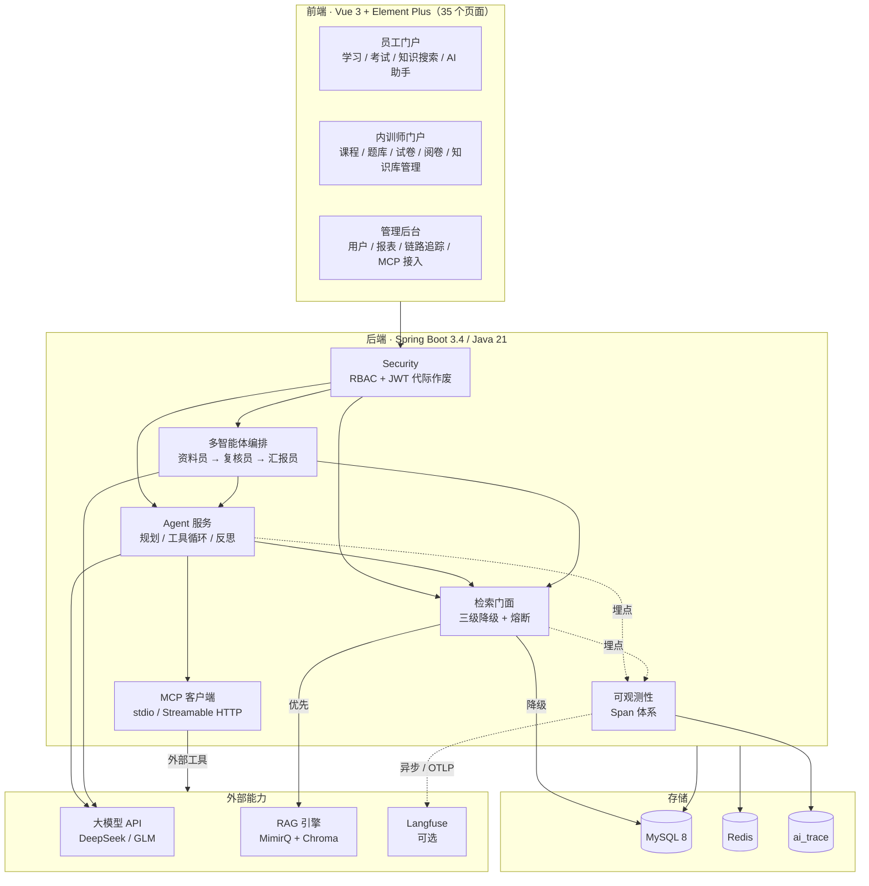

<div align="center">

# 企业培训与智能考核系统

**trainer-eval** · 把「课程 → 考试 → AI 评分 → 错因分析 → 知识检索」串成一条完整闭环

Java 21 · Spring Boot 3.4 · Spring AI · MySQL · Redis · Vue 3 · RAG · MCP · Multi-Agent

</div>

---

## 这个项目想解决什么

企业培训的典型困境是**"资料有人传，但没人找得到"**：
内训师把文档传到课程章节里，员工想查一个知识点只能一页页翻课程；
即使查到了，也不确定是不是最新版本。与此同时，主观题批改依赖人工，阅卷量大且标准难统一。

本项目把这两件事工程化：

- **学** —— 员工能用自然语言检索全站培训文档，回答**带引用编号可溯源**（而不是让模型自由发挥）
- **考** —— 题库 / 试卷 / 在线考试 / 客观题自动判分
- **评** —— 主观题 AI 辅助评分，并把 AI 建议分与教师终评分的**一致性量化**出来
- **析** —— 错题归因，建议基于真实课程资料而不是凭空生成

> 面向的是**真实工程问题**：外部依赖会挂、检索会退化、模型会编、AI 评分需要被验证。
> 所以这个项目里最花功夫的不是"把功能做出来"，而是**降级、可观测、可回归**这三件事。

---

## 核心能力

### 1. 三级降级检索链路（外部服务挂了也不中断）

```
① 外部 RAG 服务（混合召回 + 重排）
        ↓ 不可用 / 命中不足
② 本地混合检索（ngram 全文 + 子串 + RRF 融合）
        ↓
③ 子串兜底
```

- **连续失败 3 次熔断 + 60s 冷却半开重试** —— 避免每次提问都白等一个读超时
- 两路本地通道用 **RRF（Reciprocal Rank Fusion）** 融合，而不是加权求和：
  两个通道的分数量纲完全不同，归一化加权需要不停调参且不稳定，**RRF 只依赖排名、天然免疫这个问题**
- **权限裁剪放在降级链路的公共入口** —— 否则"服务挂了就降级"等于 fail-open，绕过的恰恰是权限本身
- 降级不是静默的：状态会透传到前端并明确提示"结果可能不完整"

### 2. Agent：手动工具执行循环 + 规划/反思

基于 Spring AI 的 `internalToolExecutionEnabled=false`，**由业务代码执行工具**并逐步推送过程。
不用框架内置的自动执行，是因为只有自己执行才能做到：

- **Plan → Act → Reflexion**：工具返回空或低相关时注入约束提示词换关键词重试（上限 2 次），而不是无脑重试烧 token
- 区分"纯推理步骤"与"工具步骤"，避免把已完成的汇总步骤误标为"跳过"
- SSE 实时透出规划、每次调用与结果，过程可见

### 3. MCP（Model Context Protocol）外部工具接入

自实现 JSON-RPC 2.0 客户端，支持 **stdio** 与 **Streamable HTTP** 双传输（含 SSE 响应解析、会话头回带），
外部工具自动进入模型工具列表。安全上收紧为三条边界：

| 边界 | 原因 |
|---|---|
| server 只能来自配置文件（**不开放 API 动态注册**） | stdio 传输等价于在本机执行命令，开放动态注册 = 开放远程命令执行入口 |
| 按角色白名单放行，**默认仅管理员** | MCP 工具没有用户身份，做不到本地工具那样的行级过滤；默认取最保守值，把"忘记配置"的后果从"数据泄露"降级为"功能没生效" |
| 工具结果包 `<data>` 边界 | 外部返回值是不可信输入，与课程资料同等对待 |

### 4. 多智能体协作（交叉校验）

```
资料员（带工具取证） → 复核员（无工具、独立上下文） → 汇报员（只基于已核实内容作答）
```

核心动机：**同一个模型在同一份上下文里自查是弱校验**——它已经花了几轮工具调用，
倾向于认为自己查全了。复核员**刻意不给工具**，只用一个没参与检索的新上下文回答
"这些证据够不够支撑结论"。实测效果：把回答从"硬凑一份复习清单"改成如实说明"证据不足以排序"。

### 5. Eval 与可观测性（与开发同步建设，而非事后补救）

- **Golden 题集回归**：指标 hitRate / recall / MRR，改切块参数或换 embedding 模型后可一键复跑对比
- **自研链路追踪**：一次请求拆成 `chain / generation / retriever / tool / agent` 五类 span，
  记录每跳耗时、token、模型与错误 —— 用来回答"这 8 秒慢在哪一跳"
- **双出口**：本地表永远是主路径（零依赖），Langfuse 是可选第二出口；
  导出走 **OTLP**、异步、有界队列、**失败只计数不影响业务**

### 6. 安全与工程化

- **RBAC + JWT**，且改密 / 管理员重置密码后**令牌代际作废**（旧 access token 立刻失效）
- **检索权限裁剪在工具层按用户行级过滤**（不依赖提示词要求模型"不要越权"——那不可靠）
- Excel / PDF 报表导出（POI SXSSF 流式写出、iText 中文字体回退）
- Docker 一键拉起依赖（MySQL 初始化、Redis、RAG 引擎）

---

## 实测数据

> 以下均为本项目实测，复现方式见 [`修复记录-第四轮-知识库运维与可观测性.md`](修复记录-第四轮-知识库运维与可观测性.md)

| 指标 | 结果 | 说明 |
|---|---|---|
| 端到端检索延迟 | **5040ms（降级） → 131~229ms（未降级）** | 根因是 embedding 服务每次冷启动都在联网重试 |
| 首次冷查询 | **18.8s → 2.9s** | 离线加载 + 启动预热 |
| 检索质量回归（20 题） | hitRate / recall / MRR = **1.0000 / 1.0000 / 0.9667** | 关键词基线（LIKE_BASELINE）= **0.8500 / 0.8500 / 0.8167**，提升 +0.15 / +0.15 / +0.15 |
| 单轮 Agent 对话 | ≈4.3s，其中规划 1.2s、生成 2.1s | 链路追踪实测 |
| 多智能体一轮 | ≈30s / 11266+5440 token | 约为单智能体的 3~4 倍，所以**不是默认模式** |

> ⚠️ **诚实说明**：Golden 只有 20 题，hitRate = 1.0 说明的是"**本次改动没有造成回归**"，
> **不能**说明检索质量好。语料变大后必须重测分数分布再调阈值。
>
> ⚠️ **指标口径更正（2026-10-14）**：本表此前写的"LIKE 基线 0.4500、提升 +0.55"，
> 在本仓库当前代码 + 当前 13 份教学语料下**复现不出来**。已落库的 14 次评测（`rag_eval_run` 表）
> 显示基线一直就是 **0.8500**。原因是 `GoldenEvalService.likeBaselineMaterials`
> 后来改成**先用同一套 `normalizeQuery` 清洗再做子串匹配**——去停用词后
> "数据保护三大原则是什么"退化成"数据保护三大原则"，正好等于资料 3 的标题，于是直接命中。
> 基线变强是**对**的（原先拿未清洗的问题去 LIKE 是不公平比较），但文档没跟着改，
> 于是留下了一个被夸大约 3.7 倍的"提升幅度"。现行口径下的真实提升是 **+0.15**。
> 复现：`POST /api/v1/rag/eval?topK=5`。
>
> ⚠️ **2026-10-14 修复 `ChunkingService` 的"按段落切分"死代码分支后**，
> CHAIN 的 MRR 由 1.0000 变为 **0.9667**：20 题中有 1 题（"多因素认证能解决什么问题"）
> 从第 1 位降到第 3 位——ngram 分词把"问题"这类通用词匹配到了完全无关的资料 6
> （职业健康与劳动保护），且与资料 4 的分差只有 4.6%（0.034294 vs 0.032787），本质是近似并列。
> hitRate / recall 不变，仍为 1.0000。样本量不足以断言哪种切块策略更好；
> 这恰好说明两件事：**评测集需要扩充**，以及**纯词法通道的天花板需要 cross-encoder 重排来突破**。

---

## 架构



---

## 技术栈

| 层 | 选型 |
|---|---|
| 后端 | Java 21 · Spring Boot 3.4.5 · Spring AI 1.0.0 · Spring Security · MyBatis-Plus 3.5.6 · JJWT 0.12.5 |
| 存储 | MySQL 8 · Redis（会话 / Agent 记忆 / 令牌代际） |
| 报表 | Apache POI 5.2.5（Excel，SXSSF 流式） · iText 8.0.3（PDF） |
| 前端 | Vue 3.4 · Vite 5 · Element Plus 2.7 · Pinia · vue-router 4 · ECharts 5 · Quill 2 |
| RAG 引擎 | MimirQ（第三方，见下方声明） · Chroma · bge-small-zh-v1.5 |
| 可观测性 | 自研 Span 体系 + 本地 `ai_trace` 表 · Langfuse（OTLP / legacy 双模式） |
| 部署 | Docker / docker compose |

---

## 快速开始

### 前置依赖

| 依赖 | 版本 | 说明 |
|---|---|---|
| JDK | **21** | 必需（Spring Boot 3.4 + 虚拟线程） |
| Maven | 3.8+ | |
| Node.js | 18+ | 前端构建 |
| MySQL | 8.0 | 建库 `trainer_eval` |
| Redis | 6+ | |
| RAG 引擎 | 可选 | 不部署也能跑，检索自动走本地混合 + 子串兜底 |

### 1. 准备数据库

```bash
mysql -uroot -p -e "CREATE DATABASE trainer_eval DEFAULT CHARSET utf8mb4;"
mysql -uroot -p trainer_eval < trainer-eval-server/src/main/resources/schema.sql
mysql -uroot -p trainer_eval < trainer-eval-server/src/main/resources/seed.sql
mysql -uroot -p trainer_eval < trainer-eval-server/src/main/resources/test-data.sql
```

> 可选的运维脚本在 `trainer-eval-server/src/main/resources/db/` 与 `rag/`，
> 用于菜单授权、链路追踪表、Golden 题集等，均为幂等脚本。

### 2. 配置（全部可选，不配也能启动）

复制 `.env.local.example` 为 `.env.local`：

```ini
# AI 功能（主观题批改、学习助手）需要；不填则 AI 相关接口报鉴权错误，其他功能正常
DEEPSEEK_API_KEY=sk-你的key

# RAG 引擎（可选）。不填则检索走本地混合检索，功能正常但少了混合召回 + 重排
MIMIRQ_ENABLED=true
MIMIRQ_BASE_URL=http://localhost:8000
MIMIRQ_API_KEY=mimirq-xxxx
```

### 3. 启动

**Windows 一键启动**（推荐）：

```powershell
.\start.ps1                 # 会检查 JDK / Node / MySQL / Redis，并预热检索
```

**手动启动**：

```bash
# 后端（JDK 21）
cd trainer-eval-server
mvn spring-boot:run

# 前端
cd trainer-eval-web
npm install && npm run dev
```

访问 `http://localhost:5173`

### 演示账号

| 账号 | 密码 | 角色 |
|---|---|---|
| `admin` | `admin123` | 管理员（含全部角色） |
| `employee1` | `admin123` | 员工 |

> ⚠️ **这是演示用默认凭据**。部署到任何公开环境前，请务必修改数据库口令、
> `JWT_SECRET`，并删除演示账号。

---

## 目录结构

```
trainer-eval/
├── trainer-eval-server/          # 后端（Spring Boot）—— 本项目主要代码
│   └── src/main/java/com/trainereval/
│       ├── agent/                # Agent：规划 / 工具循环 / 反思 / 多智能体编排
│       ├── mcp/                  # MCP 客户端（stdio + Streamable HTTP）+ 工具注册中心
│       ├── rag/                  # 检索门面：三级降级 / 熔断 / 权限裁剪 / 切块
│       ├── observability/        # 链路追踪：Span 体系 + 本地表 + Langfuse 导出
│       ├── ai/                   # AI 评分、错因分析、评分一致性度量
│       ├── exam/ questionbank/   # 考试与题库
│       ├── training/             # 课程、章节、资料
│       ├── report/               # Excel / PDF 报表
│       └── security/ system/     # 鉴权与系统管理
├── trainer-eval-web/             # 前端（Vue 3 + Element Plus，35 个页面）
├── mcp-demo-server/              # 零依赖演示 MCP server（纯 Python 标准库）
├── mimirq/                       # ⚠️ 第三方组件，见下方声明
├── start.ps1 / stop.ps1          # Windows 一键启动 / 停止
└── *.md                          # 设计文档、实施方案、修复记录与踩坑总结
```

文档索引：

| 文档 | 内容 |
|---|---|
| [`企业级RAG实施方案.md`](企业级RAG实施方案.md) | RAG 整体方案与分阶段实施 |
| [`Agent-RAG实现说明与选型理由.md`](Agent-RAG实现说明与选型理由.md) | Agent 与 RAG 的技术选型对比 |
| [`RAG实施进度与踩坑.md`](RAG实施进度与踩坑.md) | 实施进度 + **67 条踩坑记录** |
| [`修复记录-第四轮-知识库运维与可观测性.md`](修复记录-第四轮-知识库运维与可观测性.md) | 知识库运维 / 可观测性 / MCP / 多智能体 |

---

## ⚠️ 第三方组件声明

本仓库 `mimirq/` 目录是 **[MimirQ](https://github.com/skygazer42/MimirQ)** 的源码快照（**Apache-2.0**），
版权归其作者所有，保留了原始的 [`LICENSE`](mimirq/LICENSE)、[`NOTICE`](mimirq/NOTICE)，
以及记录导入来源的 [`VENDORED.md`](mimirq/VENDORED.md)（上游 commit `5d08b54` / v1.0.1）。

- **它不是本项目作者的作品**，作为可替换的 RAG 引擎被集成
- 集成方式**仅通过 HTTP 接口**（Dify External Knowledge 协议 + 写入 API），
  代码层没有对它的源码做修改性依赖 —— 因此它**完全可以替换成其它 RAG 实现**
- 之所以把源码放进仓库，是为了让依赖可以离线一键拉起；
  如果你只想看本项目代码，请看 `trainer-eval-server/` 与 `trainer-eval-web/`

**本项目作者编写的部分**：`trainer-eval-server/`、`trainer-eval-web/`、`mcp-demo-server/`
以及根目录的启动脚本与设计文档。

---

## License

本项目作者编写的部分采用 **MIT License** —— 见根目录 [`LICENSE`](LICENSE)。

Copyright (c) 2026 AL-1SOVO

> ⚠️ **例外**：`mimirq/` 目录是第三方组件 [MimirQ](https://github.com/skygazer42/MimirQ) 的未修改源码快照，
> 遵循其自身的 **Apache License 2.0**（见 [`mimirq/LICENSE`](mimirq/LICENSE) 与 [`mimirq/NOTICE`](mimirq/NOTICE)），
> **不属于上述 MIT 授权范围**。
>
> 根目录 `LICENSE` 中的 MIT 条款仅适用于：`trainer-eval-server/`、`trainer-eval-web/`、
> `mcp-demo-server/`，以及根目录的启动脚本与设计文档。
